# MusicFree-HiRes

> 基于 [MusicFree](https://github.com/maotoumao/MusicFree) `1.0.0-beta.4` 的二次开发版本，
> 集成 **Jellyfin FFmpeg** 解码扩展，补齐 **ALAC / APE / DSF / DFF** 四种高解析音频格式的播放能力。
> 原有架构、插件机制、歌单数据与设置全部保持不变。

**中文** | [English](./readme-en.md)

---

## 目录

- [项目目的](#项目目的)
- [功能特性](#功能特性)
- [支持的音频格式](#支持的音频格式)
- [目录结构](#目录结构)
- [依赖与前置条件](#依赖与前置条件)
- [构建方式](#构建方式)
- [解码模块集成点](#解码模块集成点)
- [与上游版本的兼容性](#与上游版本的兼容性)
- [测试](#测试)
- [许可与合规](#许可与合规)
- [上游 README（原样保留）](#上游-readme原样保留)

---

## 项目目的

MusicFree 是一个插件化、无广告的 Android 音乐播放器，播放能力完全依赖 Android 平台自带的
ExoPlayer / MediaPlayer 解码器。这带来一个现实问题：**平台解码器不支持无损高解析音频里最常见的几种格式**——
Monkey's Audio(`.ape`)、DSD 的两种容器 `.dsf` / `.dff`，以及容器不被广泛支持的 ALAC(`.alac`)。
这些文件在本地音乐扫描里能看到，点开却播放失败或时长为 0。

本项目的目标是在**不改动 MusicFree 原有架构与插件机制**的前提下，引入
[Jellyfin FFmpeg](https://github.com/jellyfin/jellyfin-ffmpeg) 作为旁路解码后端：

- 平台能播的格式（mp3 / flac / m4a / ogg / wav …）**一行代码都不多走**，行为与上游完全一致；
- 平台播不了的格式，由 FFmpeg 翻译成平台一定能播的容器后再交给 `react-native-track-player`；
- 解码扩展不可用时（未打包 FFmpeg、iOS、用户手动关闭）自动回退，绝不阻塞原有播放链路。

## 功能特性

**新增**

| 特性 | 说明 |
| --- | --- |
| 四种高解析格式 | ALAC、APE、DSF(DSD)、DFF(DSDIFF) 可正常播放 |
| 分级解码策略 | `passthrough` / `remux` / `transcode` / `stream`，按格式与设备能力自动选择 |
| ALAC 无损重封装 | CAF/AIFF 内的 ALAC 用 `-c:a copy` 重封装为 M4A，零音质损失、秒级完成；失败自动退化为转码 |
| DSD → PCM | 走 soxr 重采样 + 抖动整形，默认输出 24bit / 88.2kHz PCM |
| 大文件边转边播 | 超过阈值（默认 80MB）的源起本地 HTTP 流，ffmpeg 边转边推，无需等待落盘 |
| 转码缓存 | 产物按 `源地址 + 参数` 哈希缓存，LRU 清理（默认上限 2GB），重复播放不再重复解码 |
| 元数据兜底 | 平台 `MediaMetadataRetriever` 读不出时长时，用 FFmpeg probe 补齐，避免扫进 0 秒的歌 |
| 设置页开关 | 解码扩展总开关、流式开关、DSD 目标采样率、无损转码目标、缓存清理 |
| 可测试 | 策略层与上游依赖解耦，`npm run test:decode` 可脱离模拟器与 node_modules 直接跑 |

**保持不变**（上游原样保留）

- 插件机制：插件协议、插件管理器、插件安装/更新/订阅逻辑零改动；
- 播放架构：`react-native-track-player` + `TrackPlayer` 单例 + 播放队列/历史/歌单；
- 数据格式：歌单、历史、配置备份的序列化格式与上游一致，备份文件可互相导入。

## 支持的音频格式

| 扩展名 | 容器 | 编码 | 平台原生 | 本项目策略 |
| --- | --- | --- | --- | --- |
| `.alac` | CAF / MP4(M4A) | ALAC | 部分（API 28+ 仅 MP4 容器） | 优先 remux → M4A，失败转码 |
| `.ape` | APE (Monkey's Audio) | APE | ❌ | 转码 → FLAC / WAV |
| `.dsf` | DSF | DSD (1bit PDM) | ❌ | DSD→PCM，默认流式 |
| `.dff` | DFF (DSDIFF) | DSD | ❌ | DSD→PCM，默认流式 |
| `.aiff` / `.aif` | AIFF | PCM / ALAC | 部分 | 转码 → FLAC / WAV |
| `.mp3` / `.flac` / `.m4a` / `.ogg` / `.opus` / `.aac` / `.wma` / `.wav` | — | — | ✅ | 直通（与上游一致） |

> DSF/DFF 播放的是 **DSD 转 PCM 后的结果**。Android 音频通路本身不接受 DSD 原始流，
> 因此必须经过一次 PCM 转换（默认 24bit/88.2kHz），这是平台限制而非实现取舍。

## 目录结构

```
MusicFree-HiRes/
├── android/
│   └── app/src/main/
│       ├── java/fun/upup/musicfree/
│       │   ├── ffmpegDecoder/
│       │   │   ├── FFmpegDecoderModule.kt     # 新增：JNI 桥，probe/transcode/startStream
│       │   │   └── FFmpegDecoderPackage.kt    # 新增：ReactPackage 注册
│       │   ├── lyricUtil/ mp3Util/ utils/     # 上游原有原生模块
│       │   └── MainApplication.kt             # 修改：+ add(FFmpegDecoderPackage())
│       ├── jniLibs/
│       │   ├── README.md                      # 新增：FFmpeg 产物放置约定
│       │   └── <abi>/libjellyfin_ffmpeg.so    # 构建期生成，不入库
│       ├── AndroidManifest.xml                # 修改：新增四种格式的 intent-filter
│       └── build.gradle                       # 修改：jniLibs.useLegacyPackaging = true
├── src/
│   ├── core/
│   │   ├── decode/                            # 新增：解码模块（核心）
│   │   │   ├── types.ts                       #   类型契约
│   │   │   ├── formats.ts                     #   格式注册表（扩展名 → 容器/编码/平台支持）
│   │   │   ├── decodePolicy.ts                #   决策：格式+probe+偏好+设备能力 → 策略
│   │   │   ├── decodeRouter.ts                #   路由：策略 → 缓存/转码/流式的执行
│   │   │   ├── decodeCache.ts                 #   转码产物缓存（RNFS + MMKV 索引，LRU）
│   │   │   ├── memoryCache.ts                 #   缓存的内存实现（单测用）
│   │   │   ├── cacheKey.ts                    #   FNV-1a 缓存键
│   │   │   └── index.ts                       #   装配入口 decodeManager
│   │   ├── trackPlayer/index.ts               # 修改：play() 6.5 步接入解码路由
│   │   ├── pluginManager/plugin.ts            # 修改：本地插件元数据 probe 兜底
│   │   ├── localMusicSheet.ts                 # 修改：批量扫描时长 probe 兜底
│   │   └── pluginManager/ musicSheet/ …       # 上游原有，未改动
│   ├── native/ffmpegDecoder/index.ts          # 新增：NativeModules.FFmpegDecoder 桥
│   ├── pages/setting/settingTypes/
│   │   ├── decoderSetting.tsx                 # 新增：解码设置 UI
│   │   └── basicSetting.tsx                   # 修改：挂载"解码扩展"分组
│   ├── constants/commonConst.ts               # 修改：supportLocalMediaType 增加新扩展名
│   ├── utils/persistStatus.ts                 # 修改：新增 "decode.prefs" 持久化键
│   └── core/i18n/languages/*.json             # 修改：三语新增解码相关文案
├── scripts/
│   ├── fetch-jellyfin-ffmpeg.mjs              # 新增：拉取/校验 FFmpeg 产物到 jniLibs
│   ├── jellyfin-ffmpeg.manifest.json          # 新增：产物 URL + SHA256 清单
│   ├── run-decode-tests.mjs                   # 新增：纯逻辑测试入口
│   └── ts-loader.mjs                          # 新增：node 解析无扩展名 TS import
├── tests/decode/                              # 新增：38 条纯逻辑测试
├── docs/
│   ├── ARCHITECTURE.md                        # 架构与数据流
│   ├── DECODER.md                             # 解码策略详解
│   ├── BUILD.md                               # Jellyfin FFmpeg 交叉编译
│   └── UPSTREAM.md                            # 与上游同步策略
└── .github/workflows/
    ├── decode-tests.yml                       # 新增：解码逻辑测试
    └── build-hires.yml                        # 新增：带 FFmpeg 的 APK 构建
```

## 依赖与前置条件

**运行时**

| 依赖 | 版本 | 说明 |
| --- | --- | --- |
| React Native | 0.76.5 | 与上游一致，未升级 |
| react-native-track-player | ^4.1.1 | 与上游一致，未替换播放器 |
| Android minSdk | 见 `android/build.gradle` | 沿用上游 |
| Jellyfin FFmpeg | 7.x | 可选；缺失时解码扩展自动禁用 |

**构建期**

- Node.js ≥ 20（跑测试需 ≥ 22，用到内置类型擦除）
- JDK 17、Android SDK、`android/gradlew`（与上游一致）
- Android NDK：**仅当需要自行交叉编译 FFmpeg 时**才需要，见 [docs/BUILD.md](./docs/BUILD.md)

本项目**没有新增任何 npm 依赖**，避免与上游 `package-lock.json` 产生冲突。

## 构建方式

```bash
# 1. 安装依赖（与上游完全一致）
npm ci

# 2. 可选但推荐：拉取 Jellyfin FFmpeg 产物到 jniLibs/
#    上游不发布 Android 产物，通常需要先按 docs/BUILD.md 自行编译，然后：
npm run fetch-ffmpeg -- --local ./out/arm64-v8a/ffmpeg --abi arm64-v8a
#    或已有可下载产物时：
npm run fetch-ffmpeg -- --url <tarball-url> --sha256 <hex> --abi arm64-v8a,armeabi-v7a

# 3. 跑一遍解码逻辑测试（不需要模拟器）
npm run test:decode

# 4. 构建 APK
npm run build-android          # Windows
# 或 cd android && ./gradlew assembleRelease
```

跳过第 2 步也能正常构建：**此时 `FFmpegDecoder.isAvailable()` 返回 false，
应用行为与上游 MusicFree 完全一致**。

## 解码模块集成点

解码逻辑对播放链路只有一个接入点，位于
[`src/core/trackPlayer/index.ts`](./src/core/trackPlayer/index.ts) 的 `play()` 中，
在"插件返回音源之后、`setTrackSource` 之前"：

```ts
// 6.5 解码扩展：ALAC / APE / DSF / DFF 等平台无法直解的格式，
//     由 Jellyfin FFmpeg 翻译成可播放源（remux / 转码 / 本地流式）
const decoded = await this.resolveDecodeSource(source.url);
if (decoded.url !== source.url) {
    source = { ...source, url: decoded.url };
}
// 7. 合并结果 -> 8. 历史 -> 9. setTrackSource（上游逻辑，未改动）
```

其余三个接入点都是"只读"的元数据兜底，不改变播放流程：

| 位置 | 作用 |
| --- | --- |
| `src/core/localMusicSheet.ts` | 批量扫描时，平台读不出时长的高解析文件用 probe 补时长 |
| `src/core/pluginManager/plugin.ts` | 单曲导入（`importMusicItem`）同上 |
| `src/constants/commonConst.ts` | `supportLocalMediaType` 增加新扩展名，让扫描能发现这些文件 |

完整调用链见 [docs/ARCHITECTURE.md](./docs/ARCHITECTURE.md)，策略细节见 [docs/DECODER.md](./docs/DECODER.md)。

## 与上游版本的兼容性

- **包名与共存**：本项目 `applicationId` 为 `fun.upup.musicfree.hires`，官方版为
  `fun.upup.musicfree`，两者**可同时安装**，互不覆盖（桌面图标显示为 MusicFree HiRes）。
  两版的歌单/设置备份文件仍可互相导入。

- **基线**：[maotoumao/MusicFree](https://github.com/maotoumao/MusicFree) `1.0.0-beta.4`
- **不改动的内容**：插件协议、插件管理器、歌单/历史/配置的数据结构、播放器主体、UI 主题体系、备份格式
- **改动方式**：全部为**新增文件 + 局部插入**，没有删除或重写上游模块（详见 `docs/UPSTREAM.md`）
- **回退保证**：`decodeManager` 的 `resolve()` 在任何异常路径下都返回原始 URL；
  设置里关闭"启用解码扩展"后，代码路径与上游逐字节等价
- **同步上游**：把上游仓库加为 `upstream` remote 定期 merge 即可，冲突面集中在
  `trackPlayer/index.ts`、`commonConst.ts`、`plugin.ts`、`localMusicSheet.ts`、`basicSetting.tsx` 五处，
  且每处改动都被注释标记，见 [docs/UPSTREAM.md](./docs/UPSTREAM.md)

## 测试

```bash
npm run test:decode
```

覆盖：扩展名归一化、格式注册表、四种格式的策略决策（含 API Level 与容器分支）、
缓存命中与 LRU、remux 自检回退、异常回退、流式/转码分发。共 38 条，无需模拟器与 node_modules。

## 许可与合规

- 本项目沿用上游 **AGPL-3.0**（见 [LICENSE](./LICENSE)）；
- Jellyfin FFmpeg 为 GPL/LGPL 混合授权的第三方组件，**不随本仓库分发二进制**，
  由 `scripts/fetch-jellyfin-ffmpeg.mjs` 在构建期拉取或由使用者自行编译；
- 二次分发时请同时保留上游出处与本项目的 FFmpeg 使用声明（见 [NOTICE](./NOTICE)）。

---

## 上游 README（原样保留）

以下内容为上游 MusicFree 的原始 README，未作删改。

---

 


<a href="https://trendshift.io/repositories/1028" target="_blank"></a>

## 简介

一个插件化、定制化、无广告的免费音乐播放器，目前只支持 Android 和 Harmony OS。

> **桌面版来啦：<https://github.com/maotoumao/MusicFreeDesktop>**

如果需要了解后续进展可以关注公众号↓；如果有问题可以在 issue 区或者公众号直接留言反馈。


软件下载方式、插件使用说明、插件开发文档可去站点 [https://musicfree.catcat.work](https://musicfree.catcat.work) 查看。

> [!NOTE]
> - 如果你在其他的平台看到收费版/无广告版/破解版，都是假的，本来就是开源项目，**遇到收费版请直接举报**；
> - 软件首先是自用，顺带分享出来希望可以帮助到有需要的人；是业余作品，会尽量保持维护，不过每天能写的时间有限（半小时左右），目测会有很长一段时间处于不稳定测试版本，且更新频率不定，请谨慎使用；
> - 软件的第三方插件、及其所产生的数据与本软件无关，请合理合法使用，可能产生的版权数据请及时删除。
> - **请不要以 VIP/破解版为噱头进行宣传**，示例仓库基于互联网公开接口封装，并**过滤掉所有 VIP、试听、付费歌曲**，且示例仓库以后也**不会提供具备破解功能的插件**；
> - 本软件的相关信息**只会主动投放在 Git 仓库以及公众号“一只猫头猫”中**，如果希望写文章介绍本软件请自便，但还烦请**如实陈述，涉及到示例仓库请给插件源打个码**，不要给软件增加一些不实的功能（尽管我也想有）；描述冲突的地方以本仓库为准。


## 项目使用约定：
本项目基于 AGPL 3.0 协议开源，使用此项目时请遵守开源协议。  
除此外，希望你在使用代码时已经了解以下额外说明：

1. 打包、二次分发 **请保留代码出处**：https://github.com/maotoumao/MusicFree
2. 请不要用于商业用途，合法合规使用代码；
3. 如果开源协议变更，将在此 Github 仓库更新，不另行通知。

> [!CAUTION]
> ### 👎 Hall of Shame
> 👎 小米/华为/vivo等<ins>应用市场的 MusicFree </ins>和本软件无关，**是套用本软件名称和 Logo 的广告软件**。
>
> 👎 速悦音乐基于本软件二次开发，改动点仅仅是内置插件、修改一些 UI 以及引流，**并未遵守本项目的开源协议，且拒绝沟通**。

---

## 特性

- 插件化：本软件仅仅是一个播放器，本身**并不集成**任何平台的任何音源，所有的搜索、播放、歌单导入等功能全部基于**插件**。这也就意味着，**只要可以在互联网上搜索到的音源，只要有对应的插件，你都可以使用本软件进行搜索、播放等功能**。关于插件的详细说明请看插件一节。

- 插件支持的功能：搜索（音乐、专辑、作者）、播放、查看专辑、查看作者详细信息、导入单曲、导入歌单、获取歌词等。

- 定制化、无广告：本软件提供了浅色、深色模式；支持自定义背景；本软件基于 AGPL 协议开源，~~一个 star 做交易~~ 将会保持免费。
- 隐私：所有的数据都存储在本地，本软件不会收集你的任何个人信息。
- 歌词关联：你可以把两首歌的歌词关联起来，比如将歌曲 A 的歌词关联到歌曲 B，关联后 A、B 两首歌都将显示歌曲 B 的歌词。你也可以关联多首歌的歌词，如 A->B->C，这样 A、B、C 三首歌都将显示 C 的歌词。

## 插件

### 插件简介

插件本质上是一个满足插件协议的 commonjs 模块。插件中定义了搜索（音乐、专辑、作者）、播放、查看专辑、作者详细信息、导入歌单、获取歌词等基本函数，插件的开发者只需要关心输入输出逻辑，至于分页、缓存等全都交给 MusicFree 控制即可。本软件通过插件来完成播放器的所有功能，这样解耦的设计也可以使得本软件可以专注于做一个功能完善的播放器，我直呼小而美。

插件开发文档可以参考 [这里](https://musicfree.catcat.work/plugin/introduction.html)

需要注意的是：

- 如果你是使用第三方下载的插件，那么请自行鉴别插件的安全性（基本上看下没有奇怪的网络请求什么的就好了；自己写的最安全，*不要安装来路不明的东西*），防止恶意代码破坏。因为第三方恶意插件导致的可能的损失与本软件无关。

- 插件使用过程中可能会产生某些和本软件无关的版权数据，插件、以及插件产生的任何数据与本软件无关，请使用者自行斟酌，及时删除数据，本软件不提倡也不会提供任何破解行为，你可以搭建自己的离线音乐仓库使用。

### 插件使用

下载 app 之后，只需要在侧边栏设置-插件设置中安装插件即可。支持安装本地插件和从网络安装插件（支持解析.js 文件和.json 描述文件；已经写了几个示意的插件：[指路这个仓库](https://github.com/maotoumao/MusicFreePlugins)，不过可能功能不是很完善）；


你可以直接点击从网络安装插件，然后输入<https://raw.gitcode.com/maotoumao/MusicFreePlugins/raw/master/plugins.json> ，点击确认即可安装。

图文版详细使用说明可以参考公众号：[MusicFree 插件使用指南](https://mp.weixin.qq.com/s?__biz=MzkxOTM5MDI4MA==&mid=2247483875&idx=1&sn=aedf8bb909540634d927de7fd2b4b8b1&chksm=c1a390c4f6d419d233908bb781d418c6b9fd2ca82e9e93291e7c93b8ead3c50ca5ae39668212#rd)，或者站点： https://musicfree.catcat.work/usage/mobile/install-plugin.html

## 下载地址

请转到发布页查看：[指路](https://github.com/maotoumao/MusicFree/releases) (如果打不开可以把 github 换成 gitcode)，公众号回复 Musicfree 也可以。

## Q&A

使用时遇到的常见问题可以看这里：[MusicFree 使用 Q&A](https://musicfree.catcat.work/qa/common.html)

技术交流/一起写点有意思的东西/技术向的闲聊欢迎加群：[683467814](https://jq.qq.com/?_wv=1027&k=upVpi2k3)~ （不是答疑群）

闲聊可以到 [QQ 频道](https://pd.qq.com/s/cyxnf0jj1)~

## WIP

如果有需要讨论的新需求，可以在公众号后台留言/提issue/或者去discussion开个话题。

## 支持这个项目

如果你喜欢这个项目，或者希望我可以持续维护下去，你可以通过以下任何一种方式支持我;)

1. Star 这个项目，分享给你身边的人；
2. 关注公众号👇或 b 站 [不想睡觉猫头猫](https://space.bilibili.com/12866223) 获取最新信息；
3. 关注猫头猫的 [小红书](https://www.xiaohongshu.com/user/profile/5ce6085200000000050213a6?xhsshare=CopyLink&appuid=5ce6085200000000050213a6&apptime=1714394544)，虽然可能不会在这里更新软件相关的信息，但也算支持啦~


感谢以下小伙伴的推荐，很意外也很惊喜 ~~~

来自**果核剥壳**的安利~ <https://mp.weixin.qq.com/s/F6hMbLv_a-Ty0fPA_0P0Rg>

来自**小棉袄**的安利~ <https://mp.weixin.qq.com/s/Fqe3o7vcTw0KDKoB-gsQfg>

## ChangeLog

[点击这里](./changelog.md)

---
本项目仅供学习参考使用，基于 AGPL3.0 协议开源；请在符合法律法规的情况下合理使用本项目，禁止用于商业目的使用。

## 应用截图

**以下截图仅为 UI 样例，软件内部不提供任何音源，不代表实际使用时表现如下图。**
#### 主界面

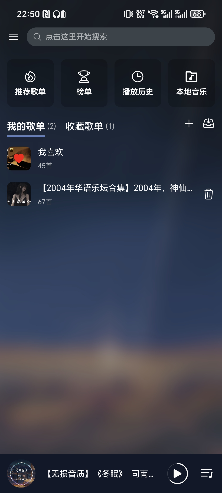

#### 侧边栏

- 侧边栏

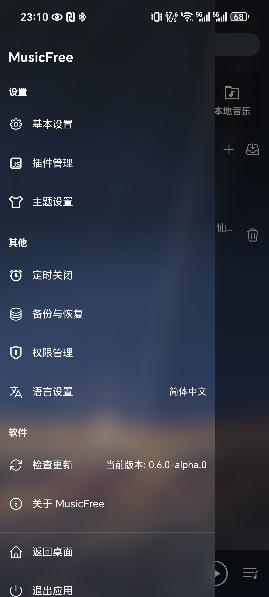

- 基础设置

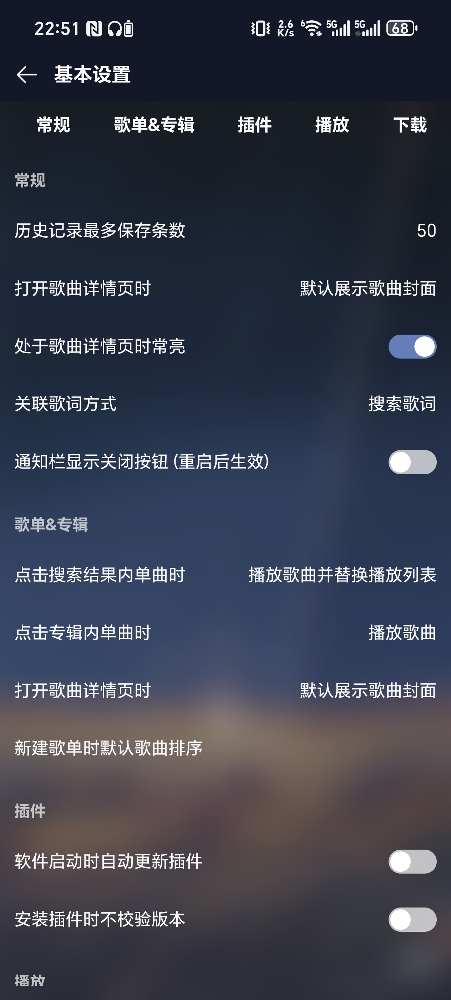

- 主题设置

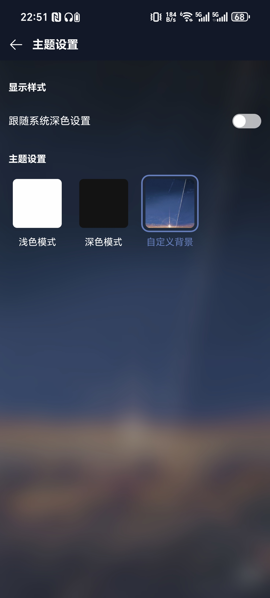

#### 音乐相关

- 歌单页

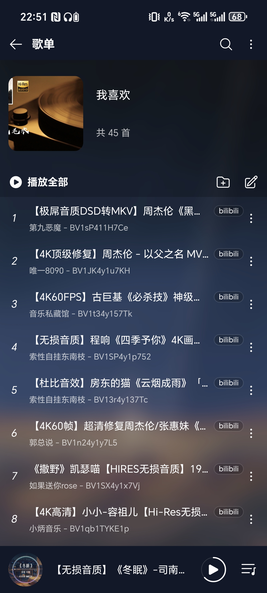

- 歌单内检索

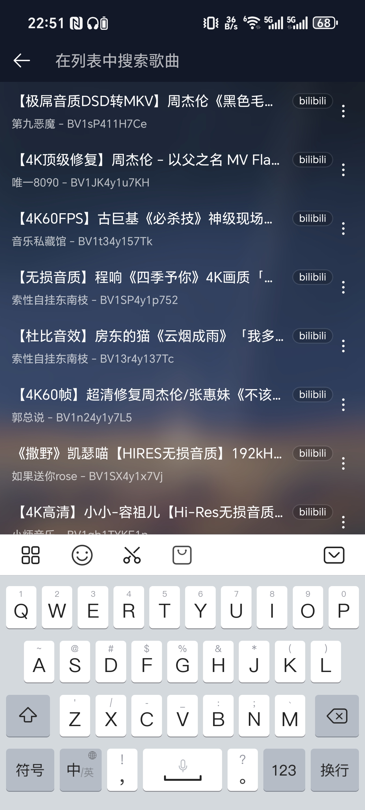

- 播放页

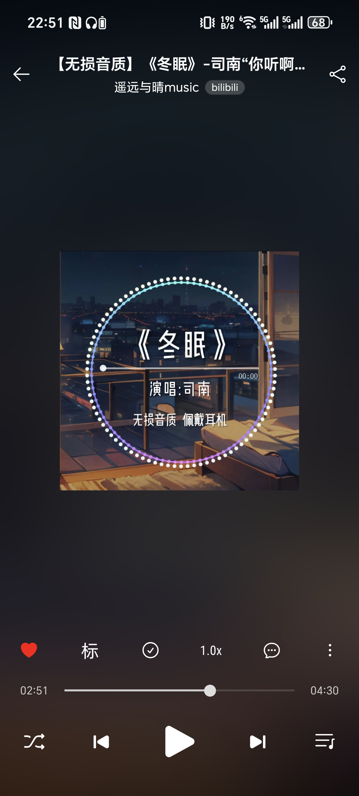

- 歌词页

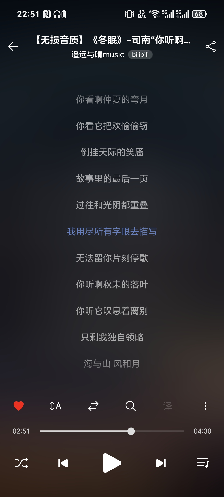

#### 搜索相关

- 作者信息

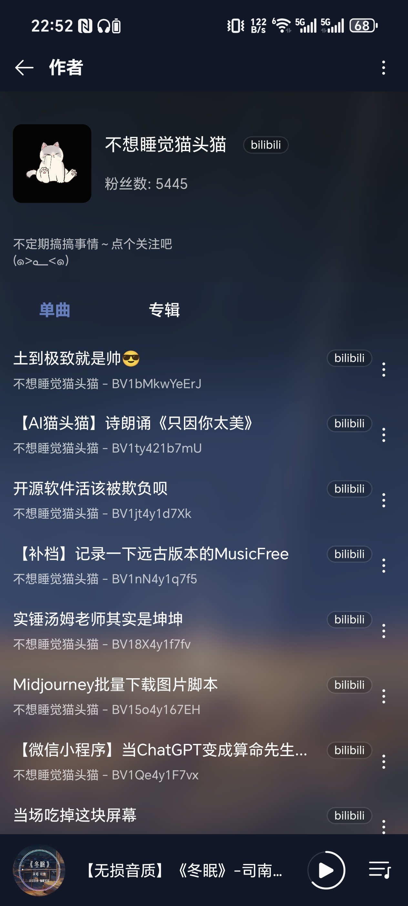


<details>


<summary>以下是软件早期版本的 UI</summary>

#### 主界面

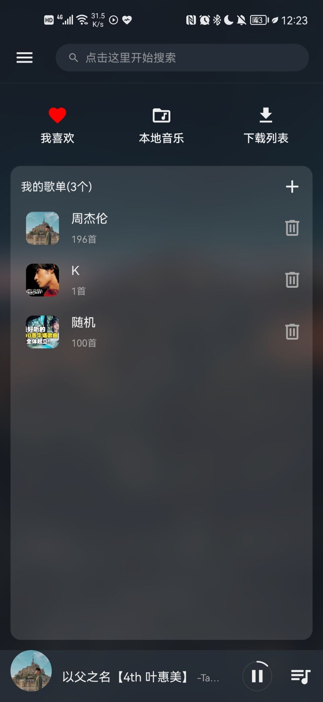

#### 侧边栏

- 基础设置

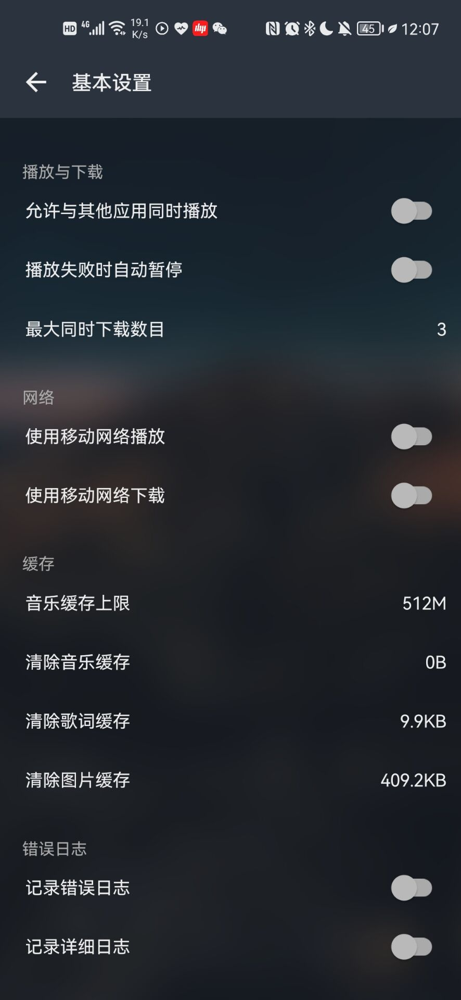

- 主题设置

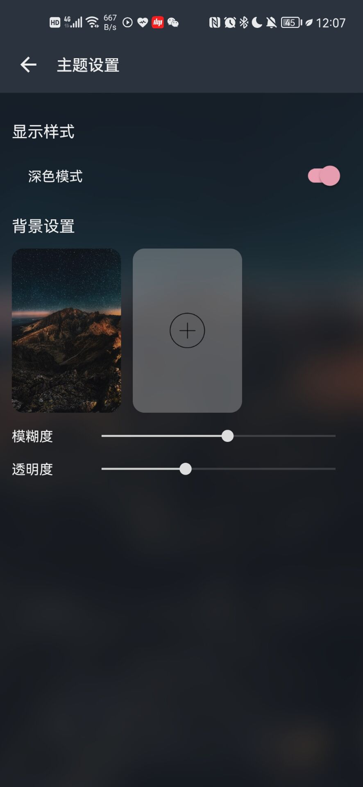

#### 音乐相关

- 歌单页

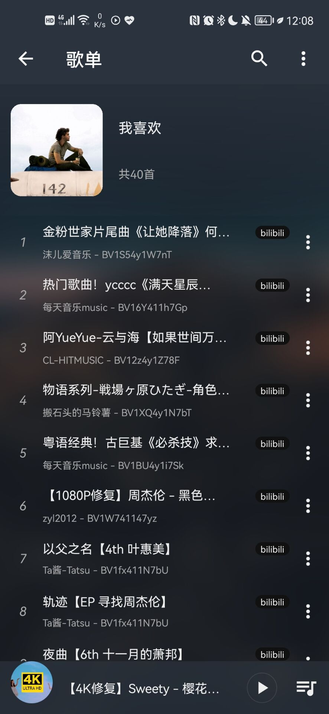

- 歌单内检索

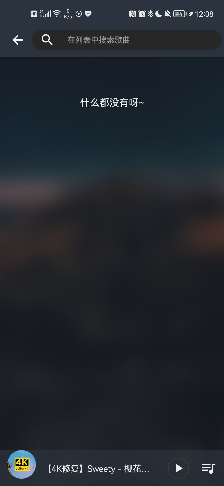

- 播放页

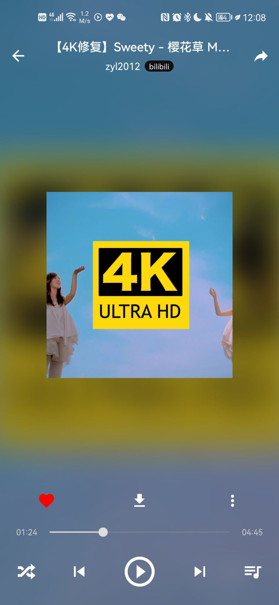

- 歌词页

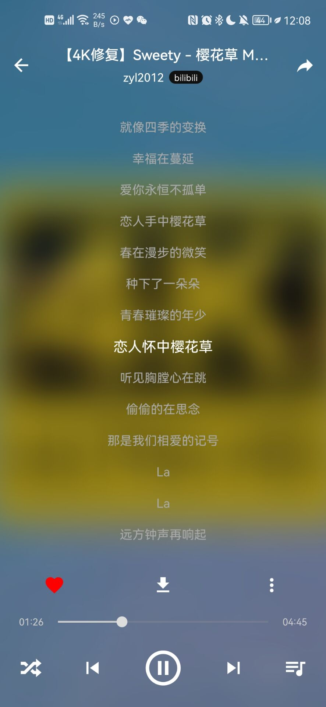

#### 搜索相关

- 作者信息

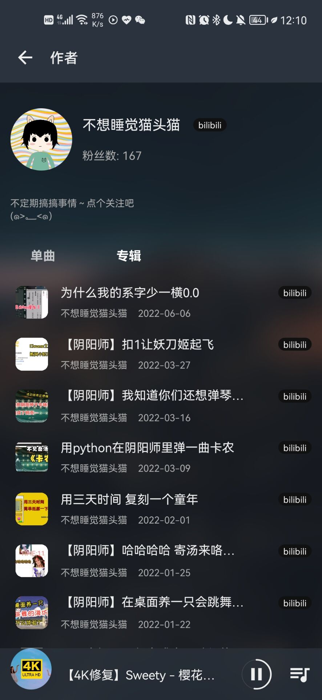


</details>
